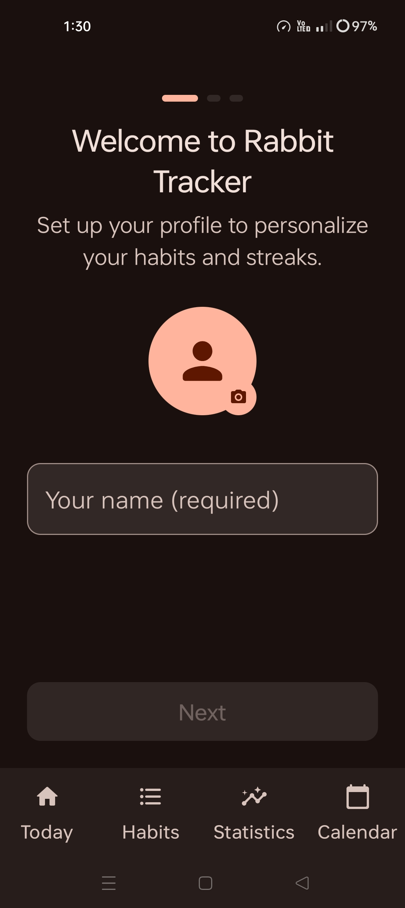
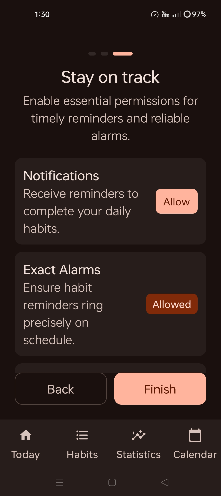
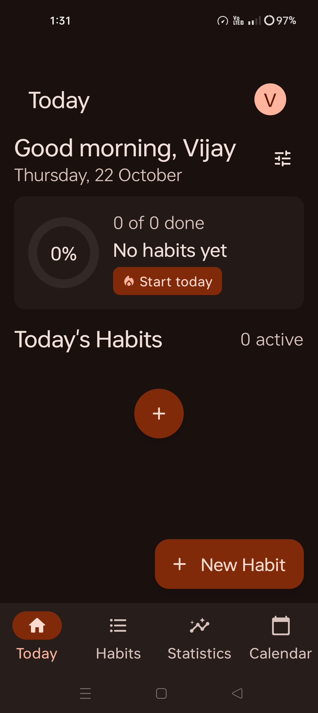
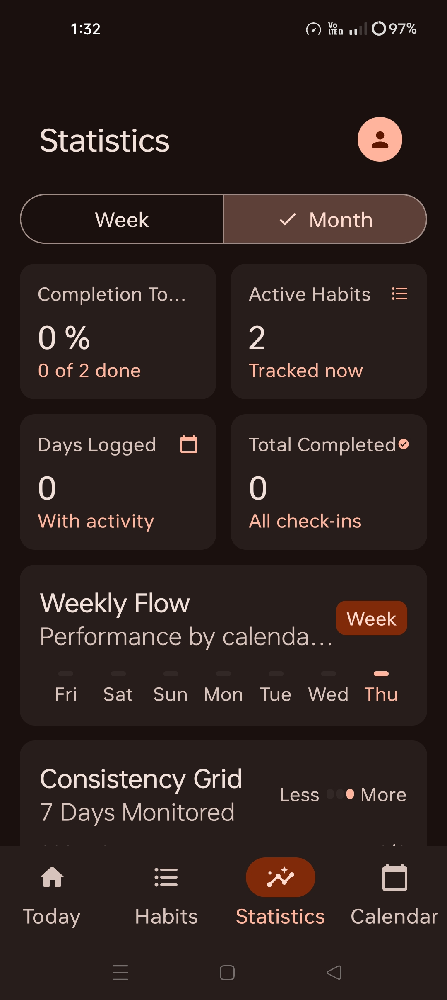
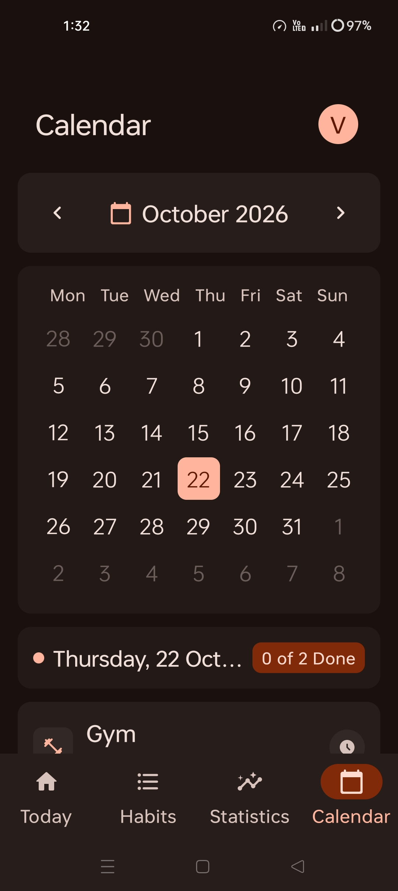
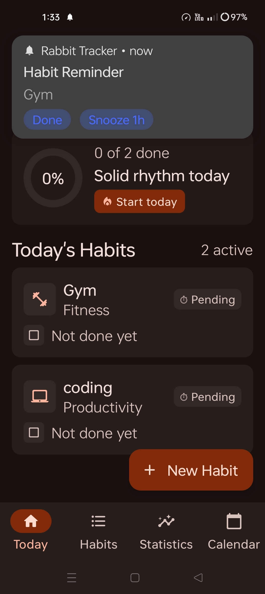
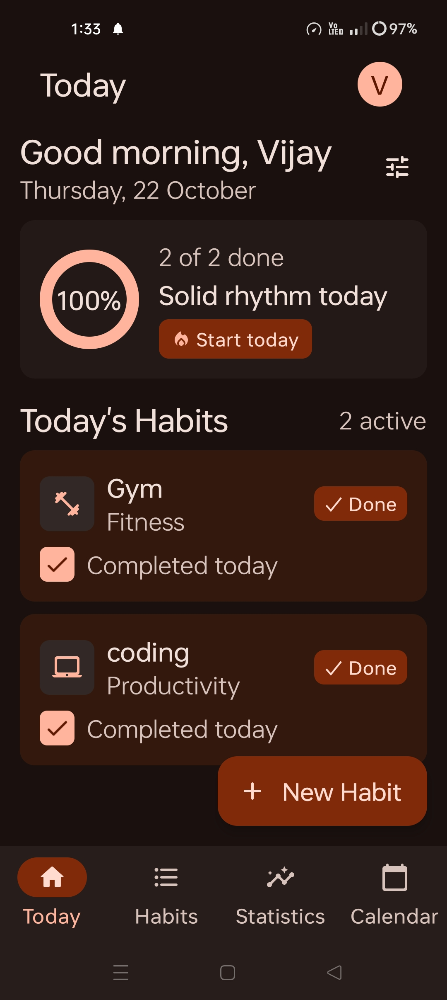

<div align="center">
  
  <h1>Rabbit Tracker</h1>
  <p><b>A fast, private habit tracker for Android — build habits, keep streaks, stay consistent.</b></p>
</div>

## 📸 Screenshots

<table>
  <tr>
    <td align="center"><br><b>Onboarding</b><br>Set up your profile</td>
    <td align="center"><br><b>Permissions</b><br>Reminders &amp; alarms</td>
    <td align="center"><br><b>Today</b><br>Empty state</td>
  </tr>
  <tr>
    <td align="center"><br><b>Statistics</b><br>Weekly &amp; monthly insights</td>
    <td align="center"><br><b>Calendar</b><br>Day-by-day history</td>
    <td align="center"><br><b>Reminders</b><br>Check in with one tap</td>
  </tr>
  <tr>
    <td align="center" colspan="3"><br><b>Daily progress</b><br>See your streak grow</td>
  </tr>
</table>

## ✨ Features

- **Daily check-ins** — tap a habit to mark it done and watch your progress ring fill up
- **Streaks & consistency grid** — keep the momentum going with a visual habit calendar
- **Statistics** — weekly and monthly completion rates, days logged and total check-ins
- **Smart reminders** — scheduled habit notifications with *Done* / *Snooze 1h* actions
- **Exact alarms** — reminders fire precisely on time, even after a reboot
- **Home screen widget** — check off habits without opening the app
- **Dark, minimal UI** — built with Jetpack Compose and Material 3
- **Fully offline** — all data stays on your device

## 🛠️ Tech Stack

| Layer | Technology |
|---|---|
| UI | Jetpack Compose, Material 3, Navigation Compose |
| Architecture | MVVM + ViewModel, Repository pattern |
| Persistence | Room (habits, logs, notes) + DataStore (profile & settings) |
| Background work | AlarmManager (exact alarms), BroadcastReceivers |
| Widget | Glance AppWidget |
| Language | Kotlin, minSdk 30, targetSdk 37 |

## 📦 Install

Download the latest release APK and install it on your device (enable *Install from unknown sources*):

[**⬇️ Download app-release.apk**](https://github.com/Mrsikarwar27/RabbitTrackerForAndroid/raw/main/app/release/app-release.apk)

Or build it yourself:

```bash
git clone https://github.com/Mrsikarwar27/RabbitTrackerForAndroid.git
cd RabbitTrackerForAndroid
./gradlew assembleRelease
```

The APK will be generated at `app/release/app-release.apk`.

## 🗂️ Project Structure

```
app/src/main/java/com/example/rabbittracker/
├── data/            # Room entities, DAOs, repositories, DataStore
├── ui/
│   ├── components/  # Bottom nav, top bar, habit icons, avatar
│   ├── screens/     # Today, Habits, Statistics, Calendar, Onboarding, Settings
│   └── theme/       # Colors, typography, theme
├── utils/           # Notifications, reminders, boot receiver
└── widget/          # Glance home screen widget
```

## 📄 License

Released under the MIT License — see [LICENSE](LICENSE) for details.

---

<div align="center">
  <sub>Made with ❤️ by <a href="https://github.com/Mrsikarwar27">Mrsikarwar27</a></sub>
</div>
